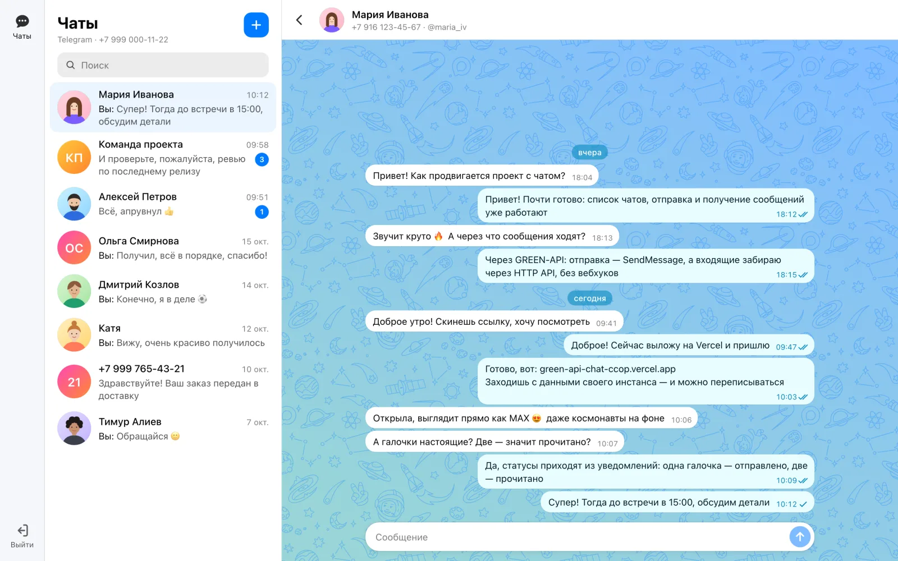
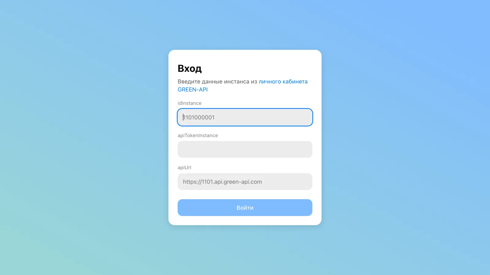
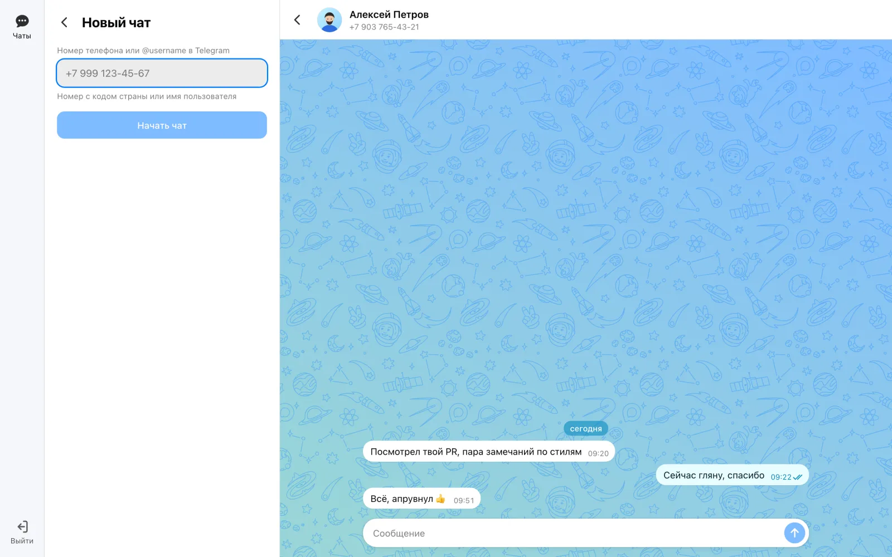
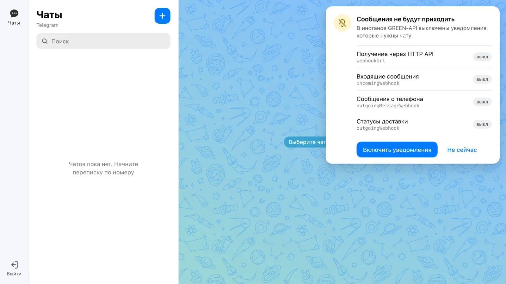
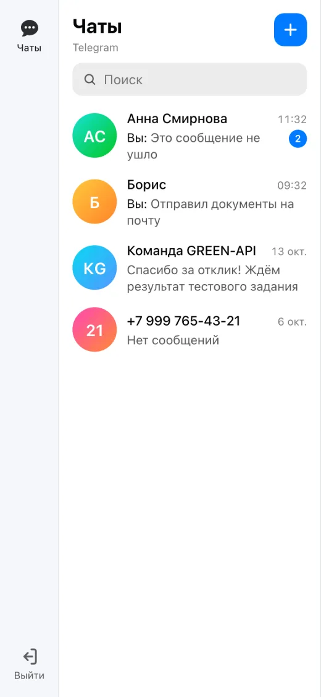
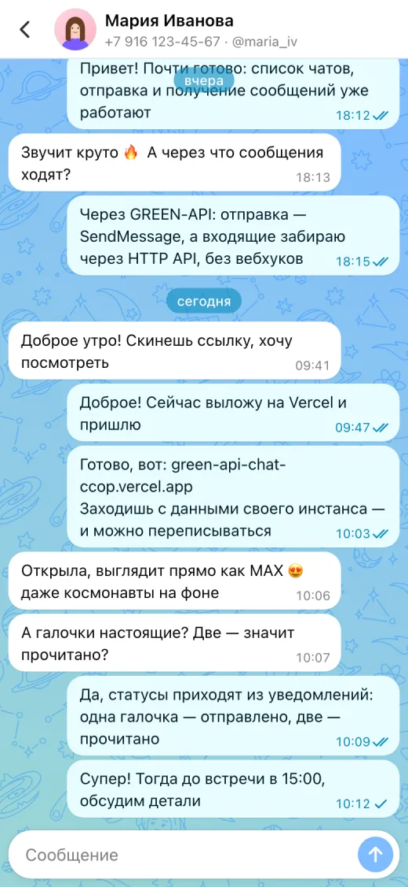

# GREEN-API Chat

Веб-клиент для отправки и получения текстовых сообщений через [GREEN-API](https://green-api.com). Внешний вид повторяет [веб-версию MAX](https://web.max.ru): тема «space» с космонавтами, пузыри сообщений, список чатов.

Тестовое задание на должность «Фронтенд-разработчик React».

**Демо:** https://green-api-chat-ccop.vercel.app — войдите с данными своего инстанса GREEN-API.



## Скриншоты

| Вход                                 | Новый чат                                    |
| ------------------------------------ | -------------------------------------------- |
|  |  |

**Проверка настроек инстанса** — если уведомления выключены, приложение показывает, что мешает, и включает нужное одной кнопкой:



**Телефон:**

<p>
  
  
</p>

На скриншотах — тестовые данные.

## Возможности

- Вход по данным инстанса GREEN-API: `idInstance`, `apiTokenInstance`, `apiUrl` (подставляется сам по `idInstance`).
- **Telegram и MAX** без переключателя — подробнее в разделе [«Почему Telegram»](#почему-telegram).
- Новый чат по номеру телефона, в Telegram — ещё и по `@username`. Номер проверяется через `CheckAccount`, уже известные номера повторно не проверяются (на тарифе Developer проверок 100).
- Имя и фото собеседника из профиля (`GetContactInfo`), инициалы на градиенте, если фото нет.
- Отправка через `SendMessage`: сообщение сразу появляется в ленте, при ошибке — кнопка «Повторить».
- Получение через HTTP API (`ReceiveNotification` + `DeleteNotification`): входящие, сообщения с телефона, статусы доставки (✓ отправлено, ✓✓ прочитано).
- Проверка настроек инстанса: если уведомления выключены, приложение показывает, что именно мешает, и включает нужное одной кнопкой.
- Поиск по чатам, счётчики непрочитанных, плашки дат, адаптивная вёрстка для телефона, планшета и десктопа.

## Быстрый старт

Нужен Node.js 20.19+ или 22.12+.

```bash
npm install
npm run dev
```

Откройте http://localhost:5173 и войдите с данными своего инстанса.

## Где взять данные инстанса

1. Зарегистрируйтесь в [личном кабинете GREEN-API](https://console.green-api.com) и создайте инстанс Telegram или MAX на бесплатном тарифе Developer.
2. Авторизуйте его: отсканируйте QR-код в приложении мессенджера (в Telegram: Настройки → Устройства → Подключить устройство).
3. Скопируйте со страницы инстанса `idInstance` и `apiTokenInstance`. `apiUrl` приложение подставит само — первые 4 цифры `idInstance`, например `https://4100.api.green-api.com`.

### Настройки уведомлений

Чтобы ответы приходили в приложение, у инстанса должны быть:

| Настройка                | Значение | Зачем                                                     |
| ------------------------ | -------- | --------------------------------------------------------- |
| `webhookUrl`             | пусто    | иначе уведомления уходят на чужой сервер, а не в HTTP API |
| `incomingWebhook`        | `yes`    | входящие сообщения                                        |
| `outgoingMessageWebhook` | `yes`    | сообщения, отправленные с телефона                        |
| `outgoingWebhook`        | `yes`    | статусы доставки и прочтения                              |

У нового инстанса всё это выключено. После входа приложение покажет баннер и предложит включить настройки сами (`SetSettings`). Инстанс перезапустится, применение занимает до 5 минут.

## Почему Telegram

В задании сказано: «если вы не можете выполнить тестовое задание для мессенджера MAX, можете сделать для WhatsApp или Telegram». Приложение рассчитано на оба мессенджера: API GREEN-API для них одинаковый, а мессенджер определяется по `typeInstance` из настроек инстанса. Отличаются только правила — длина сообщения, допустимые коды стран, поиск по `@username`; они собраны в `src/lib/messengers.ts`. Основная проверка проводилась на инстансе Telegram.

## Скрипты

| Команда                           | Что делает                                   |
| --------------------------------- | -------------------------------------------- |
| `npm run dev`                     | dev-сервер Vite                              |
| `npm run build`                   | проверка типов и production-сборка в `dist/` |
| `npm run preview`                 | локальный просмотр сборки                    |
| `npm test`                        | тесты (Vitest, Testing Library, MSW)         |
| `npm run lint`                    | линтер (oxlint)                              |
| `npm run format` / `format:check` | Prettier                                     |

## Как устроено

**Стек:** React 19, TypeScript, Vite, Zustand, CSS Modules. Запросы к GREEN-API идут из браузера напрямую — API отвечает с `Access-Control-Allow-Origin: *`, прокси не нужен.

```
src/
  api/          клиент GREEN-API, типы, тексты статусов инстанса
  store/        сессия и чаты (Zustand, сохраняются в localStorage)
  features/
    auth/       страница входа
    settings/   проверка и исправление настроек инстанса
    layout/     три колонки как в MAX, навигация, шапка
    chats/      список чатов, новый чат, имя и фото собеседника
    chat/       окно переписки, лента, поле ввода, отправка
    sync/       разбор уведомлений и поллер HTTP API
  lib/          номера, время, правила мессенджеров
  styles/       токены темы, сброс, общие кнопки и поля
```

**Получение сообщений.** Поллер в цикле вызывает `ReceiveNotification` (ждёт до 20 секунд), переводит уведомление в событие (`src/features/sync/notifications.ts`), применяет его к хранилищу и только потом вызывает `DeleteNotification`. Если удаление не прошло, уведомление придёт снова, и хранилище отбросит дубль по `idMessage`. При ошибке сети — повтор с паузой от 1 до 30 секунд и подсказка в шапке списка чатов.

Несколько решений, которые не видны снаружи:

- Своё сообщение возвращается уведомлением `outgoingAPIMessageReceived`, иногда раньше ответа `SendMessage`. Хранилище склеивает такое эхо с уже показанным сообщением, дублей нет.
- «Прочитано» в Telegram и MAX относится ко всему чату, и GREEN-API присылает статус только для последнего сообщения. Хранилище поднимает статус и у более ранних, а статусы никогда не откатываются назад.
- Группы и каналы аккаунта пропускаются: приложение работает с личными чатами.
- Чаты хранятся отдельно для каждого `idInstance` и пишутся в localStorage не чаще раза в 500 мс — при живом аккаунте уведомлений много.

## Тесты

Покрыты клиент API и разбор уведомлений на примерах из документации GREEN-API (запросы подменяет MSW), хранилища, поллер, правила номеров и сценарии интерфейса — вход, новый чат, отправка, повтор, переключение чатов.

```bash
npm test
```

## Ограничения

- Только текст, как требует задание. Фото, стикеры и прочее показываются заглушками «[Фото]», «[Стикер]».
- История — только то, что пришло уведомлениями: очередь GREEN-API хранит их 24 часа, более старую переписку приложение не загружает.
- Одна вкладка: две открытые вкладки делили бы между собой одну очередь уведомлений.
- Тариф Developer: 3 чата в месяц и 100 проверок номеров. При превышении лимита приложение покажет сообщение GREEN-API.

## Безопасность

`apiTokenInstance` даёт полный доступ к аккаунту мессенджера. Он хранится только в localStorage браузера и уходит только на `apiUrl` инстанса; «Выйти» удаляет его. Не публикуйте токен — GREEN-API передаёт его в адресе запроса, поэтому он виден, например, во вкладке Network. Если токен утёк, смените его в личном кабинете.

## Благодарности

Узор фона чата и палитра темы «space» взяты из [web.max.ru](https://web.max.ru), права на них принадлежат VK.
